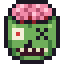
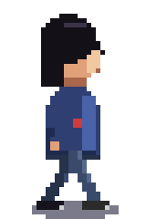
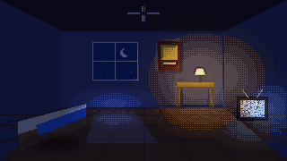
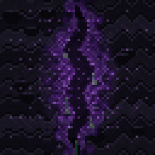
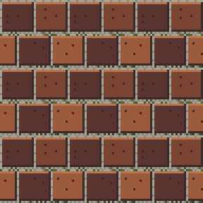

# Dead Pixel

A pixel art editor that runs in the browser, made for 2D games built in Unity, including point-and-click adventures
made with PowerQuest. It paints, animates and lights sprites, and exports straight into Unity (and Unreal).

**Try it live: [deadpixel.zombiecheese.com](http://deadpixel.zombiecheese.com/)**. Nothing to install, and nothing you
make is uploaded.

Your work never leaves your computer: projects save as `.deadpixel` files and every export downloads through the
browser. The server (or Docker container) only hands out the app's files and refuses anything but `GET`.

## Documentation

| Doc | For |
| --- | --- |
| [Wiki](https://github.com/zombiecheese/dead-pixel/wiki) | Every tool, menu and panel explained, page by page |
| [User guide](docs/GUIDE.md) | Artists: every tool, panel and export, recipes and troubleshooting |
| [Lighting](docs/LIGHTING.md) | How Dead Pixel's lighting works, render styles, light map exports |
| [Deploying](docs/DEPLOY.md) | Docker, other ways to run it, why nothing is stored on the server |
| [Project format](docs/FORMAT.md) | The `.deadpixel` file |
| [Unity](unity/README.md) · [Unreal](unreal/README.md) | Bringing sprite sheets into each engine |
| [Developing](docs/DEVELOPING.md) | Code layout, the document model, undo, adding tools and exports, the rules to keep |
| [Status and roadmap](docs/ROADMAP.md) | What has shipped, what's in progress, what's outstanding |

## Run it

| How | Command | Then open |
| --- | --- | --- |
| Live demo | | http://deadpixel.zombiecheese.com/ |
| Docker, prebuilt | `docker run -d -p 8080:8080 --read-only --tmpfs /var/cache/nginx --tmpfs /var/run --tmpfs /tmp ghcr.io/zombiecheese/dead-pixel:latest` | http://localhost:8080 |
| Docker | `docker compose up -d` | http://localhost:8080 |
| Docker, by hand | `docker build -t deadpixel . && docker run -p 8080:8080 --read-only --tmpfs /var/cache/nginx --tmpfs /var/run --tmpfs /tmp deadpixel` | http://localhost:8080 |
| No install | open `public/index.html` in a browser | |
| One file | `node tools/build.mjs --single` | `dist/deadpixel.html` (everything inlined) |

The Docker image is nginx serving `public/` with a strict content security policy, a read-only filesystem and no
upload path. The build stage runs the tests, so a broken build never ships.

## What it does

**Animation**
- Timeline matrix: frames across, layers down, cels where they cross. Shift-click frame numbers to select a range.
- Per-frame durations; tags (Walk, Idle, Jump…) with colour and direction (forward, reverse, ping-pong); play a tag on loop.
- Onion skin: frames before and after, adjustable count and opacity, red/blue tint, behind or above.
- Linked cels: one drawing shared by several frames; change it once, it changes on all of them.
- Floating preview window at 1x–8x, playing any tag, optionally lit, on checks, black, white or a night colour.

**Layers**
- Transparent layers, a background layer (opaque, erases to the secondary colour) and groups (nested, collapsible).
- Blend modes: normal, multiply, screen, overlay, darken, lighten, colour dodge/burn, hard/soft light, difference,
  exclusion, addition, subtract, divide, hue, saturation, colour, luminosity. In indexed mode the blended result is put
  back on the palette (Sprite > Keep blends on the palette).
- Opacity, visibility, lock, duplicate, merge down, move into a group.

**Drawing**
- Works with a mouse, a pen or a finger on PCs, tablets and phones. Pen pressure can set the brush size or the dither density. The pen's eraser end erases, two fingers pinch-zoom, and two- or three-finger taps undo and redo.
- Pencil, eraser, line, rectangle, ellipse (outline or filled), fill (contiguous or global), banded gradient
  (linear or radial, optional dither), eyedropper, rectangle/lasso/magic-wand selection, move.
- Pixel perfect strokes: the doubled pixel on the corner of a 1px line is removed as you draw.
- Shading ink: left button steps a pixel one shade lighter along the ramp, right button darker (the ramp is a
  palette range you shift-click, or the whole palette, sorted dark to light).
- Dither patterns ("shaders"): checker, 25/75% dots, crisscross, diagonal/horizontal/vertical lines, Bayer 4x4 at any level.
- Custom brushes from any selection (Ctrl+B), painted in their own colours or as a shape in the primary colour.
- Tiled mode (horizontal, vertical, both) wraps drawing and shows the neighbours, for seamless textures and tiles.
- Symmetry: mirror across X, Y or both.
- RotSprite rotate and scale (Scale2x three times, turn, sample back), and flips, on a selection, a cel or every frame.
- Zoom 100%–6400% with a pixel grid, a tile grid of any size, pan with Space or the middle button.
- Outline (around or on the edge, 4- or 8-way), trim canvas to content, mirror a tag into a new one (WalkR to WalkL).
- A reference image to trace over, and a check that highlights pixels off the palette.
- A History panel of every undo step; undo is capped by memory (256 MB by default), not steps.
- Save back to the same file and Open recent (Chrome, Edge), a warning before losing unsaved work, and rebindable
  keyboard shortcuts.

**Colour**
- RGB (true colour with alpha) or indexed. In indexed mode a palette edit recolours that colour everywhere; reordering,
  sorting and deleting keep the picture as it was.
- Palettes: load (a set of room palettes, DB16, DB32, Game Boy, EGA, CGA, greys), append, copy and paste as hex,
  reorder by dragging, sort, resize, extract from the frame or any image (median cut), import/export `.gpl`, `.pal`,
  `.hex`, swatch `.png`.
- HSV picker with alpha, hex and RGBA fields; tint, shade, tone and hue-shifted ramp rows; a ramp builder; gradient maps.

**Lighting**
- `LightMapGenerator`, matching a Unity C# implementation line for line: a light map per frame (surface direction + light mask) with
  the Character, Object and Architecture presets, and room planes (floor line or one-point box) for rooms.
- The `RoomFxSim` light pass: ambient grade, darkness, lamp pools (colour, intensity, radius, flatten, height, flicker:
  lamp, fluoro, candle, neon, beacon), shadow pools, the glow share and the colour limits.
- Render styles: bands with dithered seams, hard bands, 4x4 ordered dither, 2x2 checker, noise dither or
  smooth, with any number of light steps.
- Views: lit, light only, light-map normals, light-map mask. Lamps are dragged on the canvas with the light tool (K).
- Exports the light map in a Unity-ready encoding (R,G direction, B mask, A coverage) and lit renders.

## Samples

Open them from **File > Samples**. Each one switches on the view settings it shows off. The same projects are in
[`samples/`](samples) as `.deadpixel` files (open them with File > Open) with a GIF preview of each.

| | Sample | Shows off |
|---|---|---|
|  | **Walk cycle** (32×48) | Indexed colour (recolour one swatch and every frame changes), a group of body-part layers, a multiply shadow, a linked cel (the badge), Walk and ping-pong Idle tags, onion skin, the preview window |
|  | **Lit room** (320×180) | The lighting with room planes, flickering lamp, fluoro TV and moonlight, a shadow light, the banded render style, a fan turned with RotSprite, TV static, a screen-blend window glow on linked cels |
|  | **Portal pulse** (64×64) | An FX loop: linked rock and crack cels, the growth breathing outward, ooze dripping, a screen glow, a Neon flicker and the dither render style |
|  | **Brick tile** (32×32) | Tiled mode (draw across an edge and it wraps), the tile grid, dither-pattern mortar, a multiply moss layer and a rivet custom brush |

The samples are drawn in code (`public/js/samples.js`); `node tools/make_samples.mjs` rewrites `samples/`.

## Bringing in existing Unity art

`node tools/import_unity.mjs <unity project> <output folder> [--only Hero,Kitchen] [--strip MyGame] [--moods Resources] [--no-clip]` converts a Unity / PowerQuest
project's art into `.deadpixel` files:
- **Characters**: every `.anim` clip becomes a tag with its timings, and sprites are lined up on their pivots.
- **Rooms**: a layer per prop, placed from the room prefab, and the room's lighting from its mood profile: its lamps, and a
  **Room mood** for each time of day and an alternate world ([Lighting](docs/LIGHTING.md#room-moods)), read from
  `--moods <folder>`. The canvas is the room's bounds (its background), widened only
  for scenery wider than the room (parallax layers, a strip scrolling past a window). Props parked off-screen are cut
  off; `--no-clip` widens the canvas to hold every prop instead.
- **Other sprite folders**: frames grouped into tags by name. `--strip` drops extra folder names (such as your
  project's root folder) from the document names.

## Files

| Export | What you get | Use it in |
| --- | --- | --- |
| **Save project** | `name.deadpixel` (gzipped JSON: layers, frames, cels, tags, palette, lights) | Dead Pixel, later. Format: [docs/FORMAT.md](docs/FORMAT.md) |
| **Sprite sheet: Unity** | zip: `name.png`, `name.json`, `Editor/DeadPixelSheetImporter.cs` | Unity: sliced sprites + an animation clip per tag ([unity/README.md](unity/README.md)) |
| **Sprite sheet: Unreal** | zip: `name.png`, `name.paper2dsprites` | Unreal Paper2D import ([unreal/README.md](unreal/README.md)) |
| **Sprite sheet: generic** | `name.png` + JSON (frames, durations, tags, layers) | Godot, Phaser, your own tools |
| **Frames for PowerQuest** | zip of `Tag_0.png, Tag_1.png…` (+ `LightMaps/`); files converted from a Unity project keep each sprite's original name, size and place | A PowerQuest character's or room's Sprites folder |
| **PNG** | the frame, any scale, RGBA or indexed (palette PNG) | anywhere |
| **GIF** | the animation or a tag, any scale, optionally lit | sharing |
| **Light map(s)** | light maps for a frame or the whole sheet | your project's light map folder |

Sheets can be one row, one column, a grid, or a row per tag, with padding and a border; pivot and pixels-per-unit
go in the JSON.

## Shortcuts and developing

Shortcuts are in the [user guide](docs/GUIDE.md#12-shortcuts) and in Help > Shortcuts; every one can be changed in
View > Keyboard shortcuts. To work on the code, see [docs/DEVELOPING.md](docs/DEVELOPING.md): there are no
dependencies, and `npm test` runs the tests.

## License

Dead Pixel is free software under the [GNU General Public License v3.0 or later](LICENSE). You can use, host,
change and share it; versions you distribute must stay under the same license.
