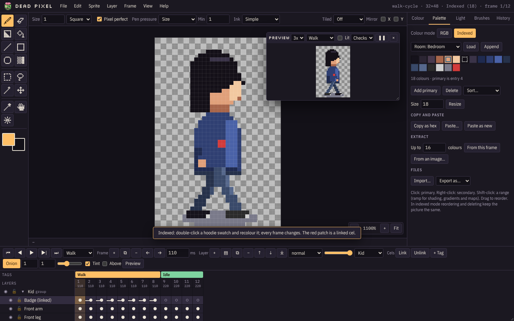

# Colour and palettes

## RGB and indexed

| Mode | How it works | Best for |
| --- | --- | --- |
| **RGB** | Every pixel has its own colour and alpha. | Concept work and anything with soft alpha. |
| **Indexed** | Every pixel points at a palette entry (up to 256). Change an entry and that colour changes everywhere, on every frame. Reordering, sorting or deleting entries keeps the picture the same. | Game-ready art and palette swaps (outfits, hair colours, day and night versions). |

Switch with **Sprite > RGB colour** or **Sprite > Indexed colour**, or the buttons at the top of the Palette tab.
Going to indexed asks:

- **Palette**: the current palette, or one made from the picture (choose how many colours to extract).
- **Dither**: none (the default), half strength or full.

Every pixel then moves to the nearest palette colour. If colours shift more than you want, load or extract a better
palette first, or undo.

In indexed mode, blend modes still work. **Sprite > Keep blends on the palette** puts each blended result back on the
nearest palette colour, so the art stays inside the palette.

## Colour tab

- A saturation/value square, a hue strip and an alpha strip, with hex and R, G, B, A fields.
- In indexed mode the colour is linked to its palette entry: editing it edits the entry, and every pixel using it.
- **Tints, shades, tones** rows and a hue-shifted **ramp** row, all made from the primary colour. Click a cell to use
  it, or click the row's name to add the whole row to the palette.
- **Ramp builder**: makes a ramp from the primary to the secondary colour in N steps, with an optional hue shift
  (lighter steps warm up, darker steps cool down).
- **Gradient map**: recolours the active layer by brightness along a ramp, on this frame or every frame.

## Palette tab

| Control | Does |
| --- | --- |
| **Colour mode** | RGB or Indexed, as above. |
| **Presets** | Room palettes ("Room: …"), DB16, DB32, Game Boy (green and grey), EGA, CGA and greys. **Load** replaces the palette; **Append** adds to it. |
| **Swatches** | Click for the primary colour, right-click for the secondary. Shift-click selects a range, used as the shading ramp, the gradient map and the ramp for gradients. Drag a swatch to reorder. Double-click to edit. |
| **Add primary** | Adds the primary colour to the palette. |
| **Delete** | Removes the selected entries. In indexed mode the picture stays the same. |
| **Sort** | By brightness, hue or saturation, or reverse. |
| **Size / Resize** | Sets how many entries the palette has. |
| **Copy as hex / Paste / Paste as new** | Passes palettes around as hex text, for example in a chat message. |
| **Extract** | Makes a palette of up to N colours from this frame or from any image (median cut). |
| **Import / Export as** | `.gpl` (GIMP, Aseprite), `.pal` (JASC), `.hex` and a swatch `.png`. |

The status line under the swatches shows how many colours there are and which entry the primary colour is.
