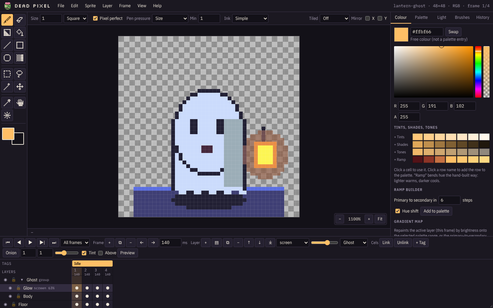
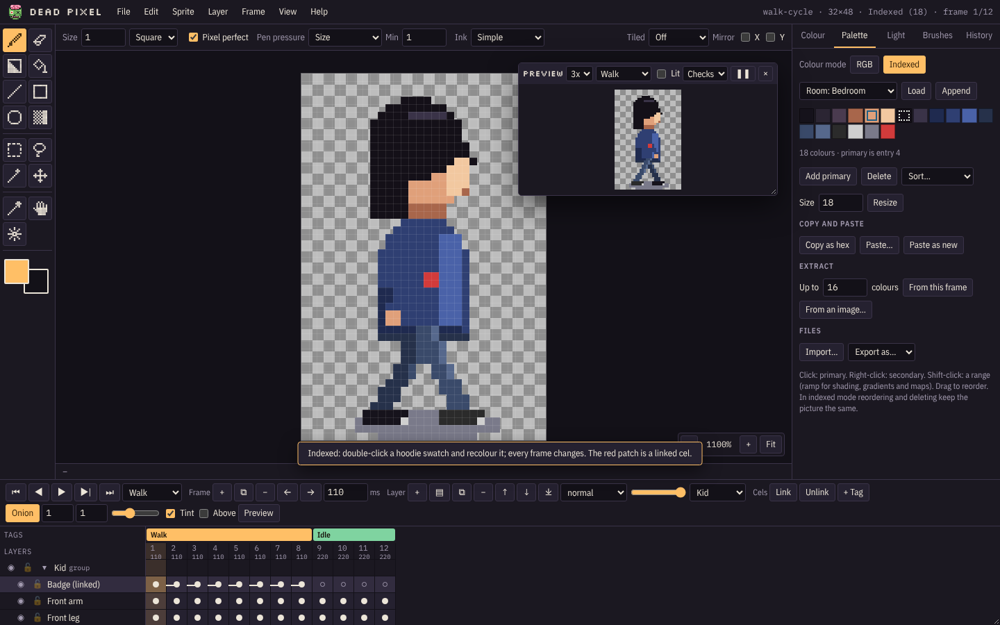

# Getting started

Open [the live demo](http://deadpixel.zombiecheese.com/) or your own copy ([Self-hosting](Self-Hosting)). Dead Pixel
works in any modern browser (Chrome, Edge, Firefox, Safari) on PCs, tablets and phones.

## The screen

| Area | What's there |
| --- | --- |
| **Menu bar** (top) | File, Edit, Sprite, Layer, Frame, View, Help. The right side shows the sprite's name, size, colour mode and the current frame. |
| **Toolbox** (left) | The drawing tools, then the primary and secondary colours. Click the small arrow or press `X` to swap them. |
| **Option bar** (above the canvas) | Settings for the current tool (size, shape, pixel perfect, pen pressure, ink), plus Tiled and Mirror. |
| **Canvas** (middle) | Scroll to zoom, Space-drag or middle-drag to pan, `0` to fit. On a tablet, two fingers pan and pinch. |
| **Panels** (right) | Colour, Palette, Light, Brushes and History tabs. |
| **Timeline** (bottom) | Playback, frame and layer buttons, onion skin, then the grid of layers × frames. |

## Try the samples

**File > Samples** opens finished projects that switch on the views they show off. They are a quick way to see
what each feature does.

| Sample | Try this |
| --- | --- |
| **Walk cycle** (32×48) | Press `Enter` to play and switch the loop between Walk and Idle. Toggle onion skin with `O`. On the Palette tab, double-click a hoodie colour and change it: every frame updates. |
| **Lit room** (320×180) | On the Light tab, change **Render style**, drag lamps with `K`, and try the light-only and light-map views. |
| **Portal pulse** (64×64) | An effects loop with linked cels (the joined dots in the timeline) and a screen-blend glow. |
| **Brick tile** (32×32) | Draw across an edge: tiled mode wraps it. Pick the rivet brush on the Brushes tab and stamp. |
| **Lantern ghost** | The start-up sprite: a small grouped, lit animation. |

## Your first sprite

1. **File > New sprite** (`Ctrl+N`). Pick a size preset (16×16 tile up to 640×180 wide room) or type one, choose RGB or
   indexed colour, a starting palette, and whether to add a background layer.
2. Draw with the pencil (`B`). Left button paints the primary colour, right button the secondary.
3. Add frames with `Alt+N` and press `Enter` to play.
4. **File > Save project** (`Ctrl+S`) to keep it as a `.deadpixel` file.
5. Export what your game needs from the File menu ([Exporting](Exporting)).

## Your work stays yours

Everything happens in the browser. The server only hands out the app's files and refuses anything but `GET`.
Your last session is kept in the browser and comes back when you reopen the page, but that is a convenience, not a
save: use **File > Save project** for anything you want to keep.
