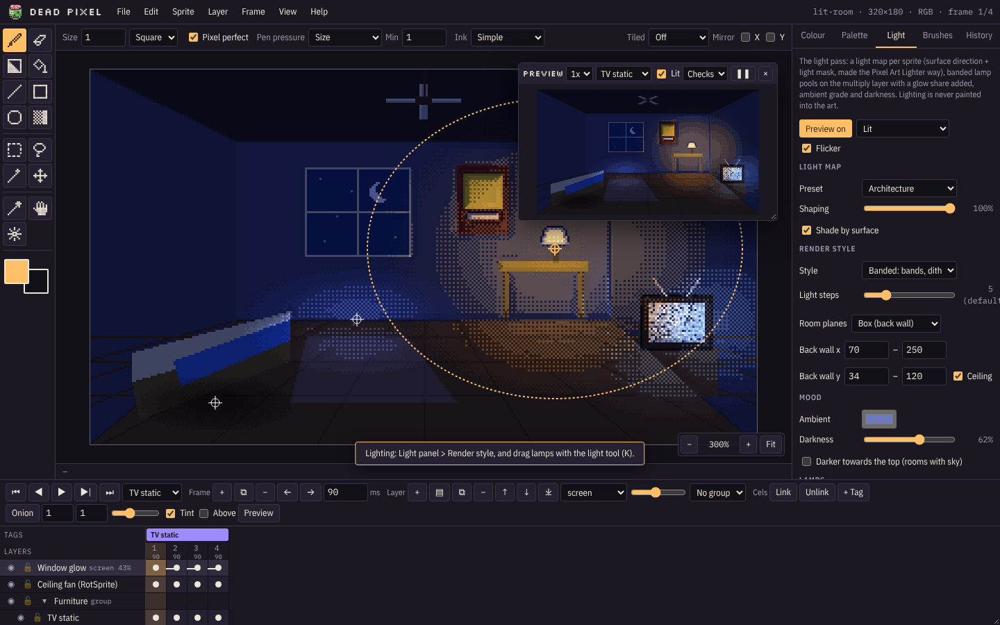

# Dead Pixel wiki

Dead Pixel is a pixel art editor that runs in the browser. It paints, animates and lights sprites, and exports them
straight into Unity, Unreal and PowerQuest games.

**Try it live: [deadpixel.zombiecheese.com](http://deadpixel.zombiecheese.com/)**. Nothing to install, and nothing you
make is uploaded: projects save as `.deadpixel` files on your own computer.

## Start here

- [Getting started](Getting-Started): the screen, the samples, your first sprite
- [Saving and opening](Saving-and-Opening): projects, imports, Open recent
- [Shortcuts](Shortcuts) and the [menu reference](Menu-Reference): every command in one place

## How each part works

| Page | Covers |
| --- | --- |
| [Drawing tools](Drawing-Tools) | Pencil, eraser, shading ink, shapes, fill, gradient, eyedropper, brushes, inks, pixel perfect |
| [Selections and editing](Selections-and-Editing) | Select, lasso, wand, move, clipboard, outline, flips, RotSprite, reference image |
| [Pens, tablets and touch](Pens-Tablets-and-Touch) | Pen pressure, eraser end, finger gestures, preferences |
| [Colour and palettes](Colour-and-Palettes) | RGB and indexed, the Colour tab, the Palette tab, palette files |
| [Layers](Layers) | Layer kinds, blend modes, groups, merge |
| [Animation](Animation) | Timeline, frames, tags, linked cels, onion skin, preview window |
| [Lighting](Lighting) | Light maps, the light pass, render styles, lamps, room moods |
| [Tiles and symmetry](Tiles-and-Symmetry) | Tiled mode, tile grid, mirror drawing |
| [Sprite and canvas](Sprite-and-Canvas) | Properties, canvas size, trim, scale, colour modes |
| [Exporting](Exporting) | PNG, GIF, sprite sheets, PowerQuest frames, light maps |
| [Unity and Unreal](Unity-and-Unreal) | Bringing sheets into each engine |
| [Importing Unity projects](Importing-Unity-Projects) | Converting existing Unity / PowerQuest art into `.deadpixel` files |
| [Recipes](Recipes) | Step-by-step: walk cycle, palette swap, lit room, seamless texture |
| [Troubleshooting](Troubleshooting) | Common problems and fixes |

## Running your own copy

- [Self-hosting](Self-Hosting): Docker, the prebuilt image, static hosting, one-file build
- [File format](File-Format): what's inside a `.deadpixel` file
- [Contributing](Contributing): code layout, tests and the project's ground rules

Dead Pixel is free software under the [GNU GPL v3](https://github.com/zombiecheese/dead-pixel/blob/main/LICENSE).
