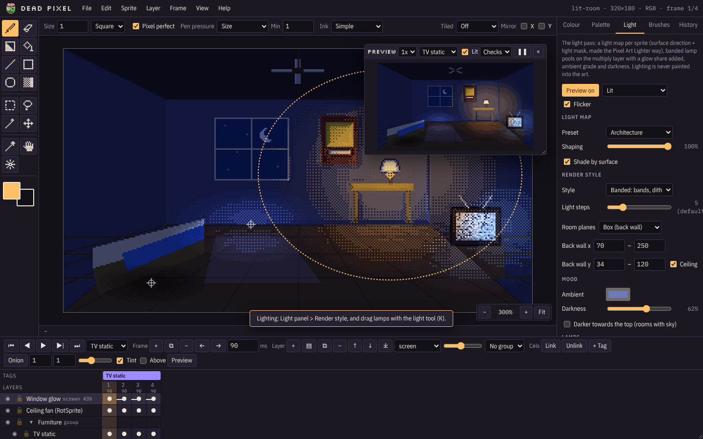

# Lighting

The **Light** tab previews and renders sprites under 2D lighting: lamps, pools of light and shadow, an ambient mood,
and surface shading from a light map. It is written to match a Unity C# lighting runtime line for line, so what you
see here is what that runtime does in the game.

Lighting is a preview and render aid. It is never painted into the cels. Turn it on and off with the Light tab's
**Preview** button or **View > Lighting preview**.

## How it works

There are two halves.

### 1. Light maps

For each frame a **light map** is made from the art. It records which way each pixel faces and how much light it
takes:

| Channel | Holds |
| --- | --- |
| R, G | surface direction (128 = facing the camera) |
| B | light mask (how much a lamp can light this pixel) |
| A | coverage (clear pixels are `128,128,0,0`) |

**Preset** sets how the art is shaped into a surface:

- **Character**: rounded bodies with a soft rim.
- **Object**: props, with harder facets.
- **Architecture**: rooms and walls, flatter. Architecture also takes **room planes**:
  - **Ground**: everything below a floor line faces up.
  - **Box (back wall)**: a one-point room. The back wall faces the camera, and the floor, ceiling and side walls
    face in toward it. Set the back wall's X and Y edges to match the art's vanishing point, and untick **Ceiling**
    for rooms without one.

**Shaping** scales how strongly the shape is applied. **Shade by surface** uses the light map's directions; off gives
flat pools of light.

### 2. The light pass

The light pass runs in this order:

1. **Ambient grade**: the art is pulled toward the ambient colour and darkened by **Darkness**. The result is banded
   over the light steps.
2. **Lamp pools**: each lamp lifts the darkness inside its radius, shaped by the light map when *Shade by surface*
   is on.
3. **Glow**: an additive share of each lamp for a warm bloom.
4. **Limits**: never darker than 0.16, and glow never above 0.4, so colours stay readable.

## Views

The drop-down next to Preview chooses what the canvas shows:

- **Lit**: the art under the lights.
- **Light only**: just the light on a grey surface, good for placing lamps.
- **Light map: normals**: the R,G direction channels.
- **Light map: mask**: the B channel.

**Flicker** animates flickering lamps in the preview.

## Render style

How light levels land on the pixels. **Light steps** sets how many bands there are (2 to 16, 5 by default).

| Style | Look |
| --- | --- |
| **Banded** | The default: flat bands with a dithered seam between them. |
| **Hard** | Flat bands with hard edges. |
| **Dither** | A full 4×4 ordered (Bayer) dither between steps. |
| **Checker** | A 2×2 checker between steps. |
| **Noise** | A stable noise dither. |
| **Smooth** | No banding: continuous light. |

Only the lighting dithers. The art itself stays dither-free.

## Mood

- **Ambient**: the colour of the unlit room.
- **Darkness**: how dark it gets away from lamps.
- **Darker towards the top**: for rooms with sky.

A new sprite 200 pixels wide or more starts with the Architecture preset and *Darker towards the top* on.

## Lamps

**Add lamp** adds one; **Remove** deletes the selected one. Drag lamps on the canvas with the lights tool (`K`, or
**Place on canvas**). Each lamp has:

| Setting | Does |
| --- | --- |
| **Name** | For your own reference. |
| **Position** | Where it sits on the canvas. |
| **Colour** and **Intensity** | The light's colour and strength. |
| **Radius** | How far the pool reaches. |
| **Flatten** | Squashes the pool into an ellipse, for light on floors. |
| **Height** | How high above the surface it is, for surface shading (-1 uses the default). |
| **Flicker** | Steady, lamp, fluoro, candle, neon or beacon (below). |
| **Shadow pool** | Darkens instead of lighting. |
| **Off** | Turns the lamp off without deleting it. |

| Flicker | Behaviour |
| --- | --- |
| Steady | None. |
| Lamp | Mostly on, dipping to about half now and then, like a bad bulb. |
| Fluoro | Steady, then every few seconds a fast on/off stutter. |
| Candle | A soft, constant flutter between 80% and 100%. |
| Neon | On, with a regular drop to near dark. |
| Beacon | A rotating sweep: a sharp bright pulse, then dim. |

## Room moods

A room converted with [`tools/import_unity.mjs --moods`](Importing-Unity-Projects) opens with the lighting its
mood profile gives it: its lamps, the glows listed for its art, and a **Room mood** list with the room's times of day
(Morning, Day, Evening, Night), an alternate world and any story moods (a storm night, for example).

Choosing a mood:

- sets the ambient colour and the darkness for that time;
- lights the lamps that only burn when the mood has its lamps on (evening and night), and puts them out by day;
- switches lights that belong to one world only;
- for the alternate world, **Undertow**, shows layers named `Undertow…` and hides layers named `Surface…` (with or
  without PowerQuest's `Prop` prefix), and back again for the other moods.

Under the list is the mood's **weather** (rain, wind, fog banks, lightning, haze). Dead Pixel doesn't draw weather;
it is listed so you know what the art will sit under. Rooms that are always at one time only list that time. Lamps
you add yourself are left alone when the mood changes, and a mood switch is one undo step.

## Getting it out

| Export | Where |
| --- | --- |
| Light map PNG for this frame | Light tab > **Light map (this frame)** |
| Light maps for every frame, as a sheet | Light tab > **Light maps sheet** |
| A lit render of this frame | Light tab > **Lit render PNG**, or This frame as PNG with **Lit** |
| A lit animation | Animated GIF with **Lit**, or a sprite sheet with **Lit render** |
| Light maps beside each frame | Frames for PowerQuest with **Light maps too** (writes `LightMaps/`) |
| A light map sheet matching a sprite sheet | Sprite sheet export with **Light map sheet too** |

The whole lighting setup (preset, planes, style, steps, mood, lamps and room moods) is saved in the `.deadpixel`
project.
