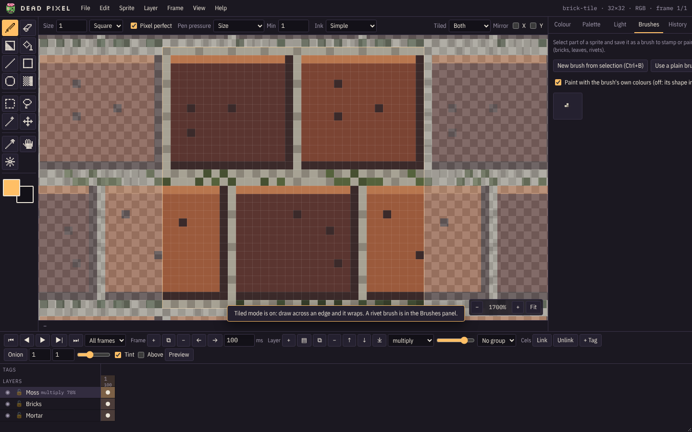

# Tiles and symmetry

## Tiled mode

Press `T` (View > Tiled mode: next) to cycle through **off**, **horizontal**, **vertical** and **both**, or use the
**Tiled** drop-down on the option bar. The canvas shows the sprite repeated around itself, and a stroke that goes off
one edge comes back in on the other. Use it for seamless floors, walls and textures.

## Grids

- **Pixel grid** (`#`, View > Pixel grid) outlines every pixel. It appears from 600% zoom.
- **Tile grid** (View > Tile grid) draws a line every N pixels, for tilesets. Set N with **View > Tile grid size**.

## Mirror drawing

Press `S`, or tick **X** and **Y** next to **Mirror** on the option bar. Every stroke is mirrored across the
sprite's centre line: X mirrors left and right, Y mirrors top and bottom, and both gives four-way symmetry.
